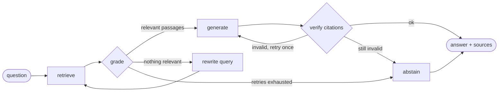

# finrag — agentic RAG over financial documentation

[](https://github.com/Chiheb-AouledAhmed/fin-rag-agent/actions/workflows/ci.yml)

A question-answering agent for banking IT and risk teams. It answers questions about regulation,
risk and market infrastructure (Basel III, IFRS 9, VaR / FRTB, MiFID II, settlement, order types)
**only from a document corpus, with a citation on every fact**, and says *"I don't know"* instead
of inventing an answer.

Built with **LangGraph** (agent workflow), **FastAPI** (service), a hybrid retriever, and an
**evaluation harness used as a quality gate in CI**.

## Agent workflow



| Node | Role |
|---|---|
| `retrieve` | hybrid TF-IDF search (word n-grams for exact terms like *CET1*, char n-grams for typos/inflections) |
| `grade` | drops passages under a relevance threshold so the model never sees off-topic context |
| `rewrite` | reformulates the query (acronym expansion, or LLM rewrite) when nothing relevant was found |
| `generate` | answers from the passages only, citing ids such as `[basel3-capital-liquidity#0]` |
| `verify` | guardrail: every citation must point to a passage actually provided; otherwise regenerate, then abstain |

## Run it

```bash
pip install -e ".[dev]"

# Offline mode (default): deterministic extractive generator, no API key needed
finrag-ask "What is the minimum CET1 ratio under Basel III?"
uvicorn finrag.api:app --reload        # then POST /ask {"question": "..."}

# With an LLM (called over plain HTTP, no SDK lock-in)
export FINRAG_PROVIDER=anthropic ANTHROPIC_API_KEY=...   # or openai + OPENAI_API_KEY
export FINRAG_MODEL=...                                  # optional, provider default otherwise
```

Docker:

```bash
docker build -t finrag . && docker run -p 8000:8000 finrag
curl -X POST localhost:8000/ask -H 'content-type: application/json' \
     -d '{"question": "When did the United States move to T+1 settlement?", "include_trace": true}'
```

Example response (offline mode):

```json
{
  "answer": "The United States moved from T+2 to T+1 for most securities on 28 May 2024. [securities-settlement#1]",
  "citations": ["securities-settlement#1"],
  "abstained": false,
  "generator": "extractive-offline"
}
```

## Evaluation

`finrag-eval` runs the agent on `data/eval.jsonl` (15 answerable + 2 out-of-scope questions) and
reports:

| Metric | Meaning |
|---|---|
| retrieval hit | the expected document is among the passages kept after grading |
| citation precision | share of cited passages that come from the expected document |
| answer recall | the answer contains the expected key fact (e.g. `4.5%`, `97.5%`) |
| abstention accuracy | out-of-scope questions get "I don't know" |

Current results with the offline generator:

```
retrieval_hit       : 1.0
citation_precision  : 1.0
answer_recall       : 0.933   <- misses the list of best-execution factors (extractive limitation)
abstention_accuracy : 1.0
overall             : 0.983
```

CI fails if the overall score drops below 0.9, so a change to chunking, retrieval or prompts that
degrades answers is caught before merge. The same harness can be run with a real LLM to compare
models or prompts.

## Project layout

```
src/finrag/
  documents.py   section-aware markdown chunking
  retriever.py   hybrid TF-IDF retriever (pluggable dense embedder)
  llm.py         generators: OpenAI / Anthropic over HTTP, offline extractive fallback
  graph.py       LangGraph state machine (retrieve / grade / rewrite / generate / verify / abstain)
  api.py         FastAPI service
  eval.py        evaluation harness + CI quality gate
data/corpus/     short reference notes on financial topics (written for this project)
data/eval.jsonl  evaluation set
```

## Limitations and next steps

- The corpus is a small set of reference notes written for this demo, not official regulatory texts;
  a production version would ingest the source documents (PDF parsing, versioning, access rights).
- The offline generator is extractive and is meant as a baseline and for CI: it needs lexical overlap
  with the documents ("US" is not matched to "United States", for example), and answer quality on
  synthesis questions requires an LLM.
- Next: dense embeddings + re-ranking, an LLM-as-judge faithfulness metric, and tracing
  (OpenTelemetry) of each node's latency and token cost.

## License

MIT
